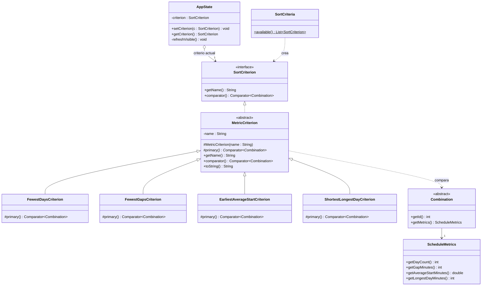
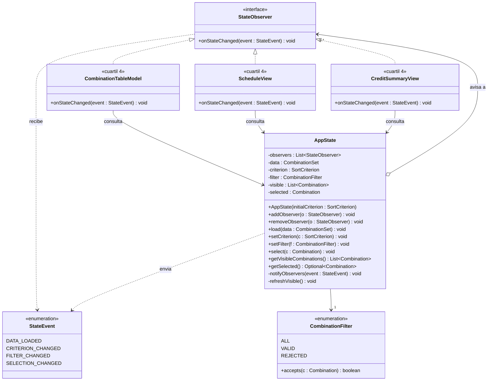
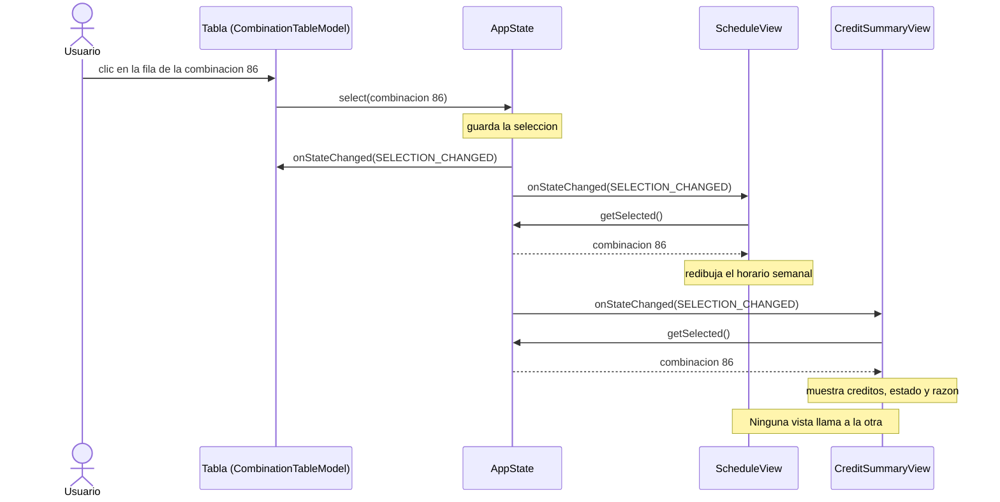
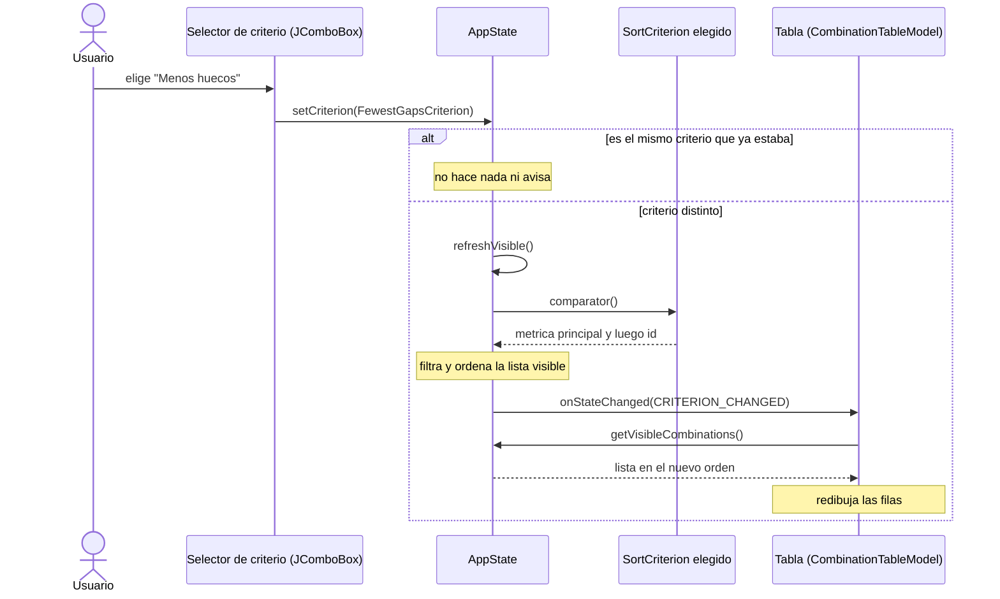

# Cuartil 3: diagramas y algoritmos (Strategy y Observer)

Material para el documento de Diseño (DI). Cada imagen PNG se genera con el codigo Mermaid
que aparece debajo de su titulo; para cambiar un diagrama, se edita ese bloque y se vuelve a
generar (por ejemplo en https://mermaid.live).

## 1. Patron Strategy: criterios de orden (`strategy.png`)

**Donde se aplica:** paquete `cemestre.sorting`.
**Problema que resuelve:** el usuario cambia el criterio de orden en ejecucion sin reiniciar y sin
cadenas `if/else` sobre el nombre del criterio.

- `SortCriterion` es la estrategia: lo unico que conoce quien ordena (`AppState`).
- `MetricCriterion` define una sola vez el desempate por id; cada subclase solo aporta su metrica
  en `primary()`.
- Las 4 estrategias concretas son intercambiables: cambiar de criterio es pasar otro objeto.
- `SortCriteria.available()` es el unico lugar donde se listan; crea objetos nuevos en cada
  llamada.

## 2. Patron Observer: estado y vistas (`observer.png`)

**Donde se aplica:** paquetes `cemestre.observer` y `cemestre.state` (sujeto) y `cemestre.view`
(observadores).
**Problema que resuelve:** al cambiar el criterio, el filtro o la seleccion, todas las vistas se
actualizan sin que el estado conozca las vistas y sin que una vista llame a otra.

- `AppState` es el sujeto: guarda una lista de `StateObserver` y les avisa cada cambio.
- El evento (`StateEvent`) solo dice que cambio; cada vista le pide a `AppState` los datos que
  necesita (modelo *pull*).
- `AppState` no importa Swing ni AWT; lo verifica la prueba `LayerDependenciesTest`.
- Las clases marcadas como cuartil 4 son las vistas que se registran como observadores.

## 3. Secuencia: seleccionar una combinacion (`secuencia_seleccion.png`)

Muestra las dos vistas sincronizadas que pide el enunciado: el horario y el resumen de creditos
se actualizan por el mismo aviso, y ninguna llama a la otra.

## 4. Secuencia: cambiar el criterio de orden (`secuencia_criterio.png`)

## 5. Algoritmos de orden

**Metricas** (las calcula `ScheduleMetrics` una sola vez al crear cada combinacion; el orden
solo las lee):

| Criterio | Clase | Ordena por (de menor a mayor) |
|---|---|---|
| Menos dias en el TEC | `FewestDaysCriterion` | cantidad de dias distintos con clases |
| Menos huecos | `FewestGapsCriterion` | minutos libres entre lecciones seguidas del mismo dia (no cuentan huecos de 10 minutos o menos) |
| Hora promedio de inicio | `EarliestAverageStartCriterion` | promedio de la hora de inicio de la primera leccion de cada dia |
| Jornada mas larga mas corta (criterio del grupo) | `ShortestLongestDayCriterion` | duracion del dia mas largo, de la primera a la ultima leccion |

**Comparador de cada criterio:** compara primero por su metrica; si dos combinaciones empatan,
compara por id (menor primero). El desempate esta en `MetricCriterion.comparator()`, que es
`final`, asi que ninguna subclase puede omitirlo. Resultado: el orden es total y siempre el mismo
para los mismos datos.

**Lista visible (`AppState.refreshVisible`)**, que se ejecuta al cargar datos, al cambiar el
criterio y al cambiar el filtro:

1. Recorrer todas las combinaciones cargadas y quedarse con las que acepta el filtro actual
   (Todas, Validas o Rechazadas). Costo O(n).
2. Ordenar esa lista con el comparador del criterio actual (`List.sort`, algoritmo TimSort,
   estable). Costo O(n log n).
3. Guardarla como lista inmutable; las vistas la leen con `getVisibleCombinations()`.

**Notificacion:** despues de cada cambio, `AppState` recorre una copia de la lista de
observadores y llama `onStateChanged(evento)` en cada uno. Si el cambio no altera nada (mismo
criterio, misma seleccion) no se avisa. Si un filtro nuevo esconde la combinacion seleccionada,
se quita la seleccion y se avisa tambien `SELECTION_CHANGED`.

**Ejemplo con los datos reales** (`outputPrologMixto.json`, 347 combinaciones):

| Criterio | Primera combinacion | Por que gana |
|---|---|---|
| Menos dias | 88 | 2 dias (pero 460 min de huecos) |
| Menos huecos | 80 | 0 min de huecos (pero 4 dias) |
| Hora promedio de inicio | 88 | empieza en promedio a las 07:30 |
| Jornada mas larga mas corta | 86 | su dia mas largo dura 230 min |
