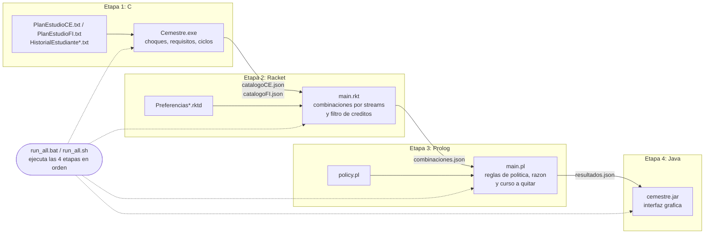
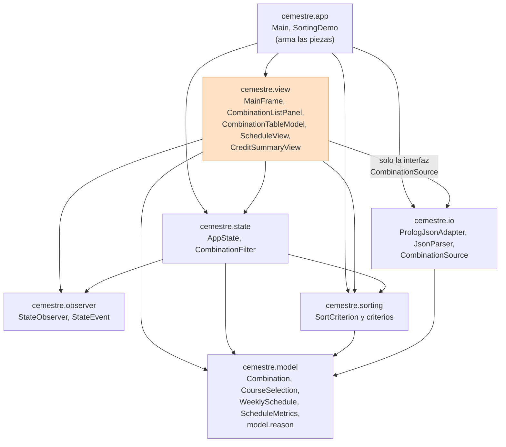
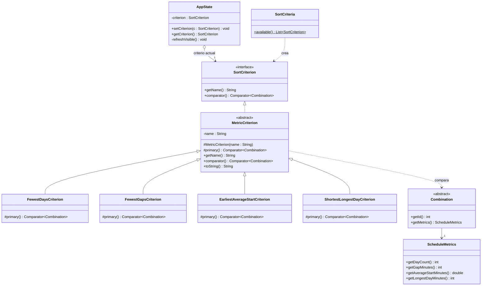
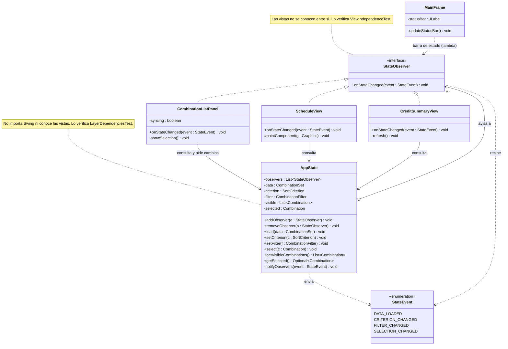
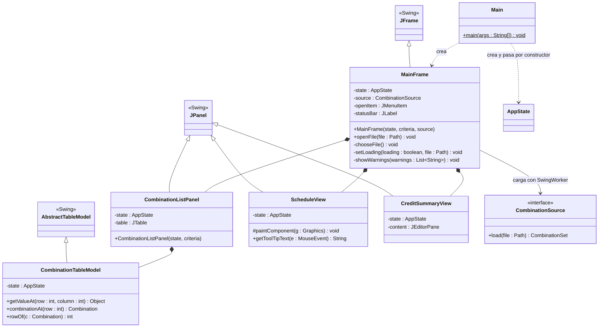
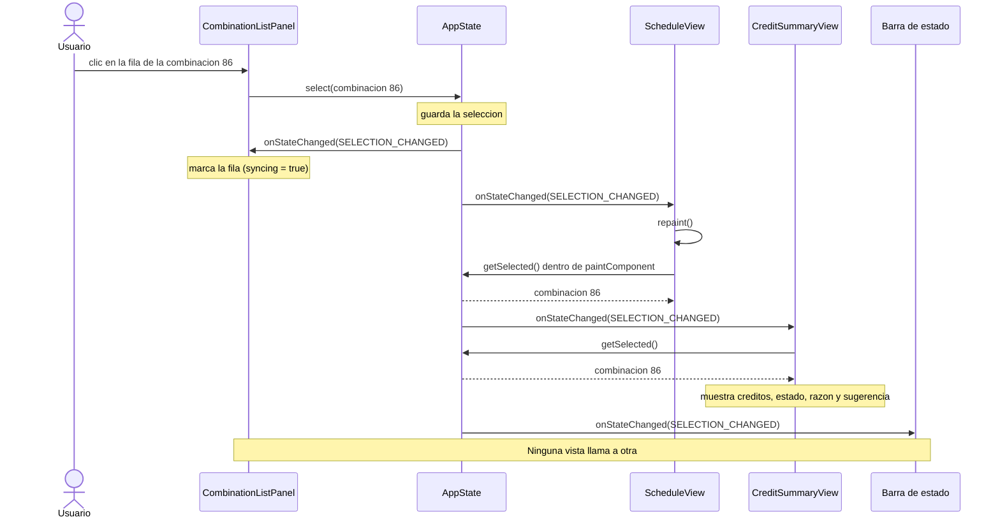
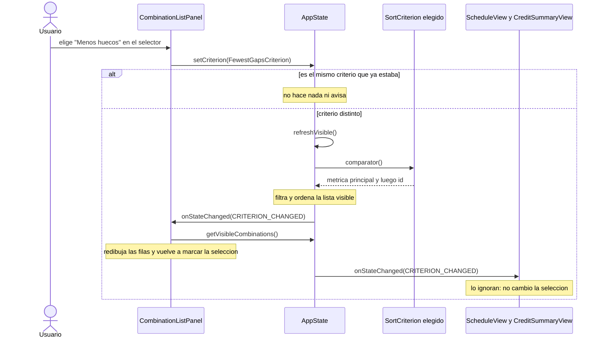
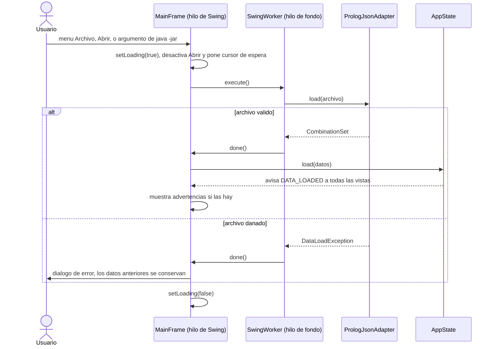

# Etapa 4 (Java): diagramas, patrones y validacion del diseno

Material para el documento de Diseno (DI). Cada PNG se genera con el codigo Mermaid que aparece
bajo su titulo; para cambiar un diagrama se edita ese bloque y se vuelve a generar
(por ejemplo en https://mermaid.live). Reemplaza a `diagramas_cuartil3.md`.

| Archivo | Tipo | Que muestra |
|---|---|---|
| `arquitectura.png` | Diagrama de bloques | Las 4 etapas, los archivos que se pasan y el script `run_all` |
| `paquetes_java.png` | Dependencias entre paquetes | Quien puede usar a quien dentro del proyecto Java |
| `strategy.png` | Clases (patron Strategy) | Criterios de orden intercambiables |
| `observer.png` | Clases (patron Observer) | `AppState` y las vistas que lo observan |
| `vista.png` | Clases | Las clases de Swing: ventana, paneles y modelo de tabla |
| `secuencia_seleccion.png` | Secuencia | Clic en una fila: las vistas se sincronizan |
| `secuencia_criterio.png` | Secuencia | Cambio de criterio de orden |
| `secuencia_carga.png` | Secuencia | Carga de un archivo en segundo plano (`SwingWorker`) |

## Patrones de diseno y donde se aplican

| Patron | Donde | Para que |
|---|---|---|
| Adapter | `cemestre.io.PrologJsonAdapter` (interfaz `CombinationSource`) | Convierte el JSON de Prolog en objetos del dominio; la interfaz grafica solo conoce la interfaz |
| Strategy | `cemestre.sorting` (`SortCriterion` y 4 criterios) | Cambiar el criterio de orden en ejecucion, sin `if/else` sobre nombres |
| Factory | `cemestre.model.reason.RejectionReasonFactory` | Crear la subclase de razon segun el campo `rule` |
| Builder (opcional) | `cemestre.model.CombinationBuilder` | Armar combinaciones validas o rechazadas |
| Observer (extra grupo de 4) | `cemestre.state.AppState` + `cemestre.observer` + vistas | Que las vistas se actualicen solas sin que el estado las conozca |

No hay Singleton: `AppState` se crea en `Main` y se pasa por constructor. Lo verifican
`ModelDependenciesTest` y `LayerDependenciesTest` (ningun `getInstance`).

## 1. Arquitectura de las 4 etapas (`arquitectura.png`)

## 2. Paquetes del proyecto Java (`paquetes_java.png`)

Las flechas van de quien usa hacia quien es usado. Solo `view` (en naranja) usa Swing.
`model`, `sorting`, `observer` y `state` no importan Swing ni AWT; lo verifican
`ModelDependenciesTest` y `LayerDependenciesTest`.

## 3. Patron Strategy (`strategy.png`)

## 4. Patron Observer (`observer.png`)

- `AppState` es el sujeto: guarda una lista de `StateObserver` y les avisa cada cambio.
- El evento solo dice que cambio; cada vista le pide a `AppState` lo que necesita (modelo *pull*).
- Cada vista reacciona solo a los eventos que le importan: la lista a todos, el horario y el
  resumen solo a `SELECTION_CHANGED` y `DATA_LOADED`.
- Ninguna vista menciona a otra; lo verifica `ViewIndependenceTest`. Solo `MainFrame` las crea.

## 5. Clases de la interfaz (`vista.png`)

## 6. Secuencia: seleccionar una combinacion (`secuencia_seleccion.png`)

## 7. Secuencia: cambiar el criterio (`secuencia_criterio.png`)

## 8. Secuencia: abrir un archivo (`secuencia_carga.png`)

## Algoritmos de orden

**Metricas** (las calcula `ScheduleMetrics` una sola vez al crear cada combinacion; el orden
solo las lee):

| Criterio | Clase | Ordena por (de menor a mayor) |
|---|---|---|
| Menos dias en el TEC | `FewestDaysCriterion` | cantidad de dias distintos con clases |
| Menos huecos | `FewestGapsCriterion` | minutos libres entre lecciones seguidas del mismo dia (no cuentan huecos de 10 minutos o menos) |
| Hora promedio de inicio | `EarliestAverageStartCriterion` | promedio de la hora de inicio de la primera leccion de cada dia |
| Jornada mas larga mas corta (criterio del grupo) | `ShortestLongestDayCriterion` | duracion del dia mas largo, de la primera a la ultima leccion |

**Comparador de cada criterio:** compara primero por su metrica; si dos combinaciones empatan,
compara por id (menor primero). El desempate esta en `MetricCriterion.comparator()`, que es
`final`, asi que ninguna subclase puede omitirlo. Resultado: el orden es total y siempre el mismo
para los mismos datos.

**Lista visible (`AppState.refreshVisible`)**, que se ejecuta al cargar datos, al cambiar el
criterio y al cambiar el filtro:

1. Recorrer todas las combinaciones cargadas y quedarse con las que acepta el filtro actual
   (Todas, Validas o Rechazadas). Costo O(n).
2. Ordenar esa lista con el comparador del criterio actual (`List.sort`, algoritmo TimSort,
   estable). Costo O(n log n).
3. Guardarla como lista inmutable; las vistas la leen con `getVisibleCombinations()`.

**Notificacion:** despues de cada cambio, `AppState` recorre una copia de la lista de
observadores y llama `onStateChanged(evento)` en cada uno. Si el cambio no altera nada (mismo
criterio, misma seleccion) no se avisa. Si un filtro nuevo esconde la combinacion seleccionada,
se quita la seleccion y se avisa tambien `SELECTION_CHANGED`.

**Ejemplo con los datos reales** (`outputPrologMixto.json`, 347 combinaciones):

| Criterio | Primera combinacion | Por que gana |
|---|---|---|
| Menos dias | 88 | 2 dias (pero 460 min de huecos) |
| Menos huecos | 80 | 0 min de huecos (pero 4 dias) |
| Hora promedio de inicio | 88 | empieza en promedio a las 07:30 |
| Jornada mas larga mas corta | 86 | su dia mas largo dura 230 min |

## Dibujo del horario (`ScheduleView`)

1. Columnas: lunes a viernes, mas sabado solo si la combinacion tiene clases ese dia.
2. Filas: desde la primera hora completa antes del primer bloque hasta la primera hora completa
   despues del ultimo (por ejemplo 07:30-20:50 se dibuja de 07:00 a 21:00).
3. Cada bloque: `y = arriba + (minutos - inicio) * alto / (fin - inicio)`, asi el alto es
   proporcional a la duracion. Se recalcula en cada dibujo, por eso se adapta al tamano de la ventana.
4. Texto del bloque: codigo, nombre, grupo y horas; lo que no cabe se recorta con "..." y el
   tooltip muestra todo.
5. Mismo color para todos los bloques de un curso. Java no detecta choques: confia en Racket.

## Validacion del diseno (lista de verificacion de la seccion 1.2 del plan)

| Requisito | Como se cumple | Evidencia |
|---|---|---|
| Cargar y unificar los datos en un modelo de objetos | `PrologJsonAdapter` convierte el JSON en `Combination`, `CourseSelection`, etc.; la interfaz y los criterios solo ven el dominio | `PrologJsonAdapterTest` |
| Mostrar TODAS las combinaciones, validas y rechazadas con su razon | Filtro "Todas" por defecto; columna y resumen con la razon de Prolog | `AppStateTest` (347 entran, 347 visibles) |
| No validar reglas ni recalcular choques | `complies` y `reason` se toman de Prolog; las metricas solo ordenan | Revision de codigo: ningun calculo de reglas en Java |
| Al menos 2 criterios de orden intercambiables en ejecucion | 4 criterios en el selector, sin reiniciar | `SortCriterionTest`, `AppStateTest` |
| Metricas definidas y empates por id | `ScheduleMetrics`; desempate en `MetricCriterion.comparator()` (`final`) | `SortCriterionTest.tiesAreBrokenById` |
| Horario semanal con codigo, nombre y grupo en su bloque | `ScheduleView` | Capturas de la interfaz |
| Jerarquia con 2 o mas subclases y polimorfismo | `Combination` (2), `RejectionReason` (3), `SortCriterion`/`MetricCriterion` (4); las vistas usan el tipo base sin `instanceof` | Revision de codigo |
| Al menos 2 patrones, sin Singleton | Strategy y Adapter (+ Factory y Builder) | `LayerDependenciesTest`, `ModelDependenciesTest` |
| Observer con dos vistas sincronizadas sin que el modelo las conozca | Horario y resumen de creditos (y la lista) observan `AppState` | `AppStateTest.everyObserverReceivesTheSameEvents`, `ViewIndependenceTest` |
| Codigo por paquetes y ejecutable con `java -jar` | Paquetes `cemestre.*`; `target/cemestre.jar` con `Main-Class` | `mvn clean package` y `java -jar` |
| Abrir cualquier salida de Prolog sin recompilar | Argumento de `java -jar` y menu Archivo > Abrir, con carga en segundo plano | Prueba manual con varios archivos |
| Recorrido de las 4 etapas con parametros cambiados | `run_all.bat` / `run_all.sh` con preferencias, politica e historiales opcionales | Corrida con `policy.pl`, `policyAreaN1.pl` y `policyCambiada.pl` |
